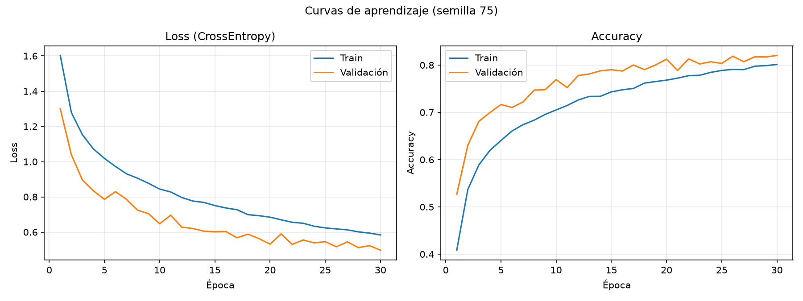
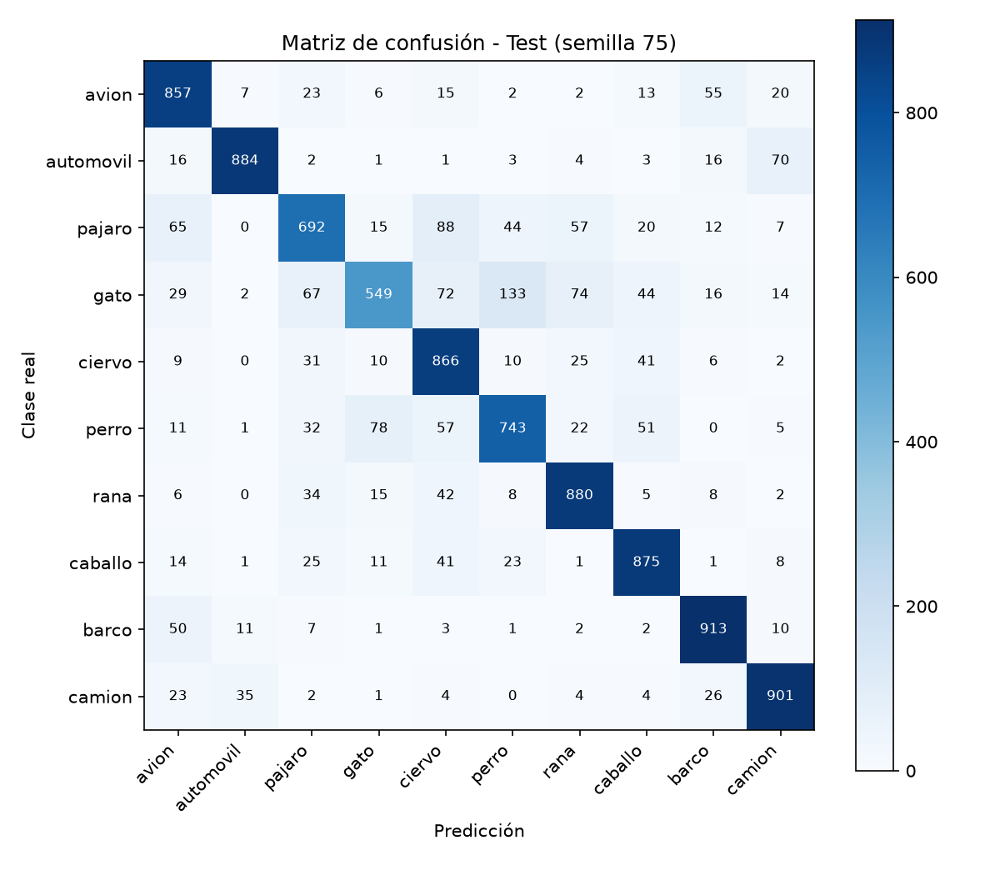

# Clasificación de imágenes CIFAR-10 con CNN en PyTorch

**Universidad Andina del Cusco – Ingeniería de Sistemas – Evaluación Segunda Unidad IA**

| Dato | Valor |
|---|---|
| Código de matrícula | 022100575k |
| **Semilla individual** | **75** (`torch.manual_seed(75)`, `np.random.seed(75)`) |
| Dataset | CIFAR-10 (60 000 imágenes RGB 32×32, 10 clases) vía `torchvision.datasets` |

## Estructura

```
src/dataset.py            # Pregunta 1: carga, semilla, transforms, partición, visualización
src/model.py              # Pregunta 3: CNN + validación de shapes 4D
src/train.py              # Pregunta 4: entrenamiento, métricas, gráficas
notebooks/experiment.ipynb# EDA, muestras y pruebas
outputs/                  # loss_accuracy.png, confusion_matrix.png, metrics.json
```

## Ejecución

```bash
pip install -r requirements.txt
python src/dataset.py     # descarga CIFAR-10, imprime particiones y guarda la cuadrícula de muestras
python src/model.py       # validación de shapes del forward pass
python src/train.py       # entrena y genera outputs/
```

---

## Pregunta 1 – Datos y transformaciones

- **Semilla 75** aplicada a `torch`, `numpy` y `random` (`set_seed`), al `Generator` del `DataLoader` y a la partición.
- **Pipeline de entrenamiento:** `RandomCrop(32, padding=4)` → `RandomHorizontalFlip(0.5)` → `ToTensor` → `Normalize(media=(0.4914, 0.4822, 0.4465), std=(0.2470, 0.2435, 0.2616))`.
- **Validación/Test:** solo `ToTensor` + `Normalize` (sin aumento, para medir sin ruido).
- **Partición estratificada** (10 % por clase, semilla 75):

| Conjunto | Imágenes | Shape de un batch |
|---|---|---|
| Entrenamiento | 45 000 | (128, 3, 32, 32) |
| Validación | 5 000 | (128, 3, 32, 32) |
| Prueba | 10 000 | (128, 3, 32, 32) |

## Pregunta 2 – Justificación teórica: CNN frente a MLP

### Por qué un MLP es ineficiente en CIFAR-10

1. **Explosión de parámetros.** Una imagen de 32×32×3 se aplana a 3 072 entradas. Una sola capa oculta de 1 024 neuronas ya requiere 3 072 × 1 024 ≈ **3,1 millones** de pesos; con imágenes de mayor resolución (224×224×3 ≈ 150 528 entradas) la cifra supera los 150 millones. Esto aumenta el costo de cómputo y memoria y, sobre todo, el riesgo de **sobreajuste**, pues el modelo tiene mucha más capacidad que datos.
2. **Pérdida de la estructura espacial.** Al aplanar, se descarta la vecindad 2D: el MLP no sabe que el píxel (i, j) está junto al (i, j+1). Debe aprender esa relación desde cero para cada posición.
3. **Sin invariancia a la traslación.** Si un gato aparece desplazado unos píxeles, las entradas activas cambian por completo y cada neurona del MLP lo ve como un patrón distinto; haría falta aprender el mismo detector una vez por cada posición posible.

### Cómo lo resuelven las CNN

| Propiedad | Qué hace | Efecto |
|---|---|---|
| **Conexiones locales** (campo receptivo) | Cada neurona de una capa convolucional solo ve una ventana pequeña (3×3) | Captura bordes y texturas locales; reduce enormemente las conexiones |
| **Weight Sharing** | El mismo filtro se desliza por toda la imagen | Un filtro 3×3×3 tiene solo 27 pesos + 1 sesgo, sin importar el tamaño de la imagen |
| **Equivarianza/invariancia a la traslación** | El mismo detector responde en cualquier posición; el `MaxPool2d` aporta invariancia local | Reconoce el objeto aunque cambie de lugar |
| **Jerarquía de características** | Las capas apiladas componen bordes → texturas → partes → objetos | Representaciones cada vez más abstractas |

Ejemplo cuantitativo en este proyecto: la primera capa `Conv2d(3→32, 3×3)` tiene **896** parámetros; una capa densa que produjera la misma cantidad de activaciones (32×32×32 = 32 768) desde 3 072 entradas necesitaría ≈ **100 millones**.

### Arquitectura implementada (`src/model.py`)

| # | Capa | Salida (N = batch) | Parámetros |
|---|---|---|---|
| 0 | Entrada | (N, 3, 32, 32) | – |
| 1 | Conv2d(3→32, 3×3, pad 1) + BatchNorm + ReLU | (N, 32, 32, 32) | 960 |
| 2 | MaxPool2d(2) | (N, 32, 16, 16) | – |
| 3 | Conv2d(32→64, 3×3, pad 1) + BatchNorm + ReLU | (N, 64, 16, 16) | 18 624 |
| 4 | MaxPool2d(2) | (N, 64, 8, 8) | – |
| 5 | Conv2d(64→128, 3×3, pad 1) + BatchNorm + ReLU | (N, 128, 8, 8) | 74 112 |
| 6 | MaxPool2d(2) | (N, 128, 4, 4) | – |
| 7 | Flatten | (N, 2048) | – |
| 8 | Linear(2048→256) + ReLU + Dropout(0.5) | (N, 256) | 524 544 |
| 9 | Linear(256→10) | (N, 10) | 2 570 |

Total ≈ **620 810** parámetros. Cumple el requisito de ≥ 2 bloques `Conv2d + ReLU + MaxPool2d` (aquí 3) y capas `Linear` hacia las 10 clases. `BatchNorm2d` y `Dropout` se añaden para estabilizar el entrenamiento y regularizar.

**Conexión conv → densa:** `nn.Flatten()` y el tamaño de entrada de `fc1` se calcula dinámicamente (`_infer_flat_dim`) pasando un tensor ficticio, lo que evita el error *Shape Mismatch*.

## Pregunta 3 – Validación de tensores 4D

`python src/model.py` ejecuta `validate_forward_pass()`, que pasa un lote simulado `(8, 3, 32, 32)` e imprime cada shape intermedio, con `assert` sobre la salida `(8, 10)` y sobre la dimensión del aplanado (2048). El mismo bloque se ejecuta automáticamente al iniciar `train.py`.

## Pregunta 4 – Entrenamiento y análisis

**Configuración:** `CrossEntropyLoss`, `Adam(lr=1e-3, weight_decay=1e-4)`, 30 épocas, batch 128. Se guarda el checkpoint con mejor accuracy de validación y se evalúa una sola vez en el conjunto de prueba.

### Resultados (semilla 75)

> ⚠️ **Completar tras ejecutar `python src/train.py`.** Los valores se imprimen en consola y se guardan en `outputs/metrics.json`. No se incluyen cifras inventadas.

| Métrica | Valor |
|---|---|
| Accuracy train (época final) | _por completar_ |
| Accuracy validación (época final) | _por completar_ |
| Accuracy test | _por completar_ |
| Brecha train − val (accuracy) | _por completar_ |
| Época con menor val loss | _por completar_ |




### Análisis crítico (redactar con sus números)

Criterios cuantitativos que usa `train.py` para el diagnóstico:

- **Overfitting:** brecha de accuracy train − val > 10 puntos porcentuales, o la val loss sube más de 0,10 respecto a su mínimo mientras la train loss sigue bajando.
- **Underfitting:** accuracy baja (< 70 %) tanto en train como en validación, con curvas que se aplanan pronto.
- **Buen ajuste:** brecha < 5 p.p. y val loss estable.

Puntos a comentar en su análisis: (1) valores finales y brecha; (2) en qué época la val loss alcanza su mínimo; (3) efecto del Data Augmentation, `Dropout` y `weight_decay` sobre la brecha; (4) clases con peor desempeño en la matriz de confusión; en CIFAR-10 suelen confundirse **gato↔perro**, **ciervo↔caballo** y **automóvil↔camión**; (5) mejoras posibles (más épocas con *learning rate scheduler*, más profundidad, *early stopping*).
